# Roll Ready user guide

Roll Ready helps you prep a tabletop campaign and run it at the table. It keeps your world notes,
session log and encounters in one place, runs initiative, shows a clean view of the fight on a
second screen, and has dice, timers, generators and a soundboard within one click or one key.
It works fully offline and keeps everything on your computer.

Roll Ready is 5E compatible and built for the 2024 rules. Its built-in rules, spells, items and
monsters come from the open SRD 5.2.

**On macOS, use ⌘ wherever this guide says Ctrl.**

## Contents

- [Getting started](#getting-started)
- [Finding your way around](#finding-your-way-around)
- [Prep: your campaign world](#prep-your-campaign-world)
  - [NPCs, locations, factions and quests](#npcs-locations-factions-and-quests)
  - [Your party](#your-party)
  - [Encounters](#encounters)
- [Sessions and notes](#sessions-and-notes)
- [Running combat: the initiative tracker](#running-combat-the-initiative-tracker)
- [The player view](#the-player-view)
- [Dice](#dice)
- [Countdown timers and the stopwatch](#countdown-timers-and-the-stopwatch)
- [Rules, spells and monsters](#rules-spells-and-monsters)
- [Pinned reference panels](#pinned-reference-panels)
- [Showing pictures to the players](#showing-pictures-to-the-players)
- [Generators](#generators)
- [Emergency NPC](#emergency-npc)
- [Soundboard](#soundboard)
- [Recording a session](#recording-a-session)
- [The command palette](#the-command-palette)
- [Settings](#settings)
- [Your data, backups and restoring](#your-data-backups-and-restoring)
- [Keyboard shortcuts](#keyboard-shortcuts)
- [Troubleshooting](#troubleshooting)

---

## Getting started

The first time you open Roll Ready, type a name for your campaign and press **Enter**.

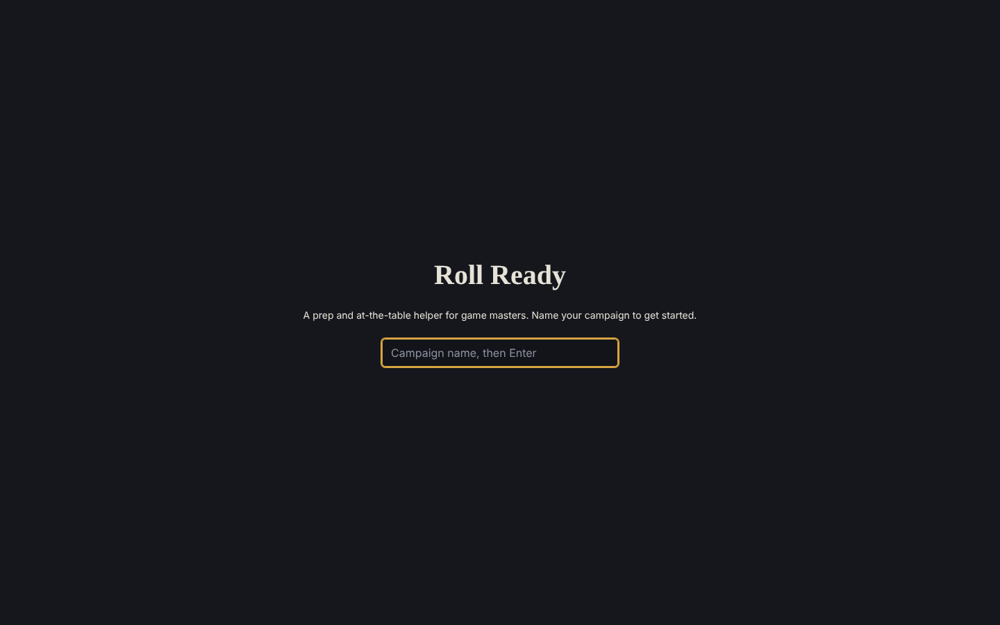

A good first ten minutes:

1. **Party:** add your players' characters.
2. **Encounters:** build a fight and check its difficulty.
3. **Run encounter:** load it into the initiative tracker and play a round or two.
4. **Player view:** press **Ctrl+Shift+P** and drag the window to a second screen.
5. Press **?** to see every keyboard shortcut.

You can have as many campaigns as you like. Switch between them with the drop-down at the top of
the sidebar, and create new ones in **Settings & about**.

> **Upgrading from DM Helper?** The first time Roll Ready starts, it copies your DM Helper data and
> upgrades the copy. Your original file is left untouched.

## Finding your way around

- **Sidebar (left):** every screen, grouped into *At the table*, *Campaign* and *Library*. The
  numbers show how many entries each one holds.
- **Top bar:** the tools you need mid-session, on every screen:
  - **🔍 Ctrl K**: the [command palette](#the-command-palette).
  - **LIVE** and the quick-note field: write a note to the session you're running (**Ctrl+J**).
    If no session is live, this shows **▶ Start session** instead.
  - **● Rec**: [record the session](#recording-a-session).
  - **🎲 2d6+3**: the quick-roll box (**Ctrl+E**). The number beside it is your last roll.
  - **🎲** (the dice button): the [dice roller and roll history](#dice) (**Ctrl+D**).
  - **⏳ Timers**: [countdown timers](#countdown-timers-and-the-stopwatch).
  - **00:00**: the stopwatch (**Ctrl+T**).
  - **⚡ NPC**: the [emergency NPC generator](#emergency-npc) (**Ctrl+N**).
- **Bottom of the sidebar:**
  - **Theme**: switches between following your system, dark and light.
  - **Shortcuts**: the full shortcut list.
  - **Save status**: Roll Ready saves as you type. "✓ All changes saved" tells you it's done; there
    is no Save button.

### Undo instead of "Are you sure?"

Deleting something happens straight away, and a message at the bottom of the window offers
**Undo** for about seven seconds. The same goes for removing a combatant and clearing the tracker.
Only three things ask first, because they can't be undone: deleting a whole campaign, deleting a
recording, and restoring a backup.

The deletion becomes permanent when the message disappears. If you switch to another program
while the message is showing, the deletion is made permanent at that moment and Undo goes away.

---

## Prep: your campaign world

### NPCs, locations, factions and quests

These four screens work the same way. Type a name in the dashed box at the top of the list and
press **Enter**: the entry exists and is open on the right. Everything you type saves by itself.

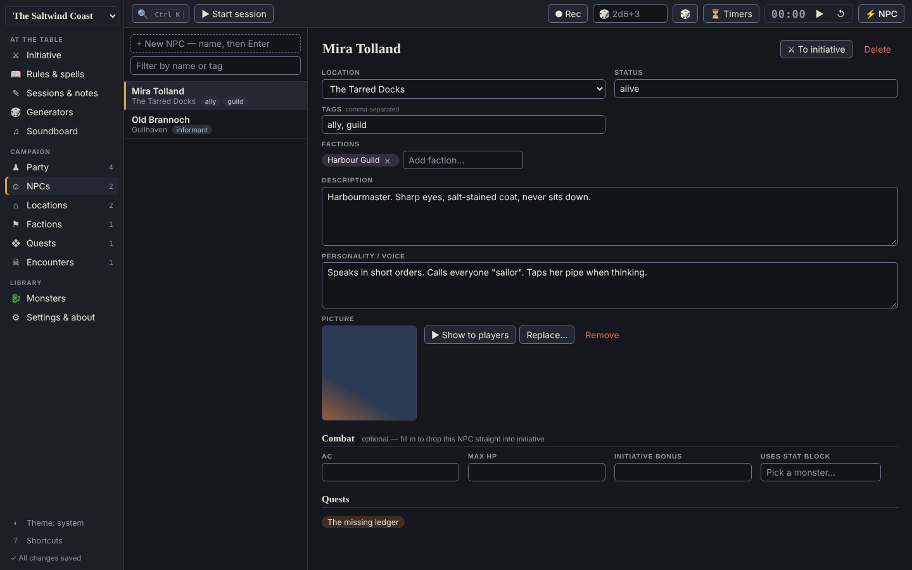

- **Link anything to anything.** Pick a location for an NPC, add NPCs to a faction, attach NPCs and
  locations to a quest. Linked names appear as chips; click a chip to jump to it, or its × to
  unlink. If you type a name that doesn't exist yet, you can create it on the spot.
- **Tags** are comma-separated words (`ally, guild`). The filter box above each list matches
  names and tags.
- **Locations can sit inside other locations** ("The Tarred Docks" inside "Gullhaven"). A location
  shows the NPCs currently there and the places inside it.
- **NPCs** have a status (alive, dead, missing…), a description, a personality and voice field, and
  an optional **Picture** you can [show to the players](#showing-pictures-to-the-players).
- **NPC combat numbers** are optional. Fill in AC, max HP and initiative bonus, or pick a monster
  under **Uses stat block**, and **⚔ To initiative** drops the NPC straight into the tracker.
- An NPC or quest page lists the session notes that mention it.

### Your party

Add your players' characters once per campaign under **Party**: name, player, AC, max HP and
initiative bonus. They're loaded into the tracker every time you run an encounter.

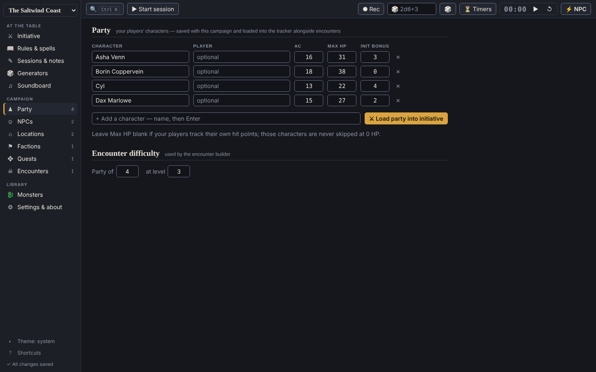

- Leave **Max HP** blank for characters whose players track their own hit points. Those
  characters are never skipped in initiative.
- **⚔ Load party into initiative** adds anyone who isn't there yet.
- **Party of … at level …** at the bottom is what the encounter builder uses to judge difficulty.
  **Use party size** sets it to the number of characters listed.

This is not a character sheet, on purpose: it holds just enough to run initiative.

### Encounters

Build a fight ahead of time, then load it into the tracker with one click.

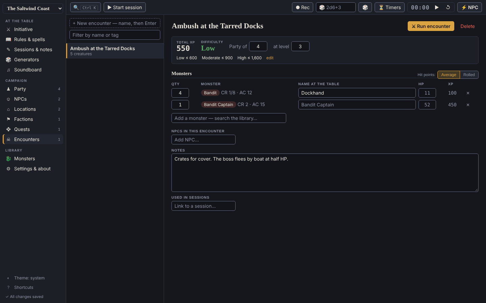

1. Create an encounter and give it a name.
2. **Add a monster** searches the monster library. Set the quantity for each line.
3. Optionally give a line a **Name at the table** ("Dockhand" instead of "Bandit") or a fixed **HP**.
4. Choose **Hit points: Average** to use the listed HP, or **Rolled** to roll each creature's
   hit dice when the encounter starts.
5. Add any NPCs taking part, and notes on terrain and tactics.

The box at the top shows the **total XP** and a **difficulty** (Low, Moderate, High or Beyond
high) for your party's size and level, with the XP limit for each tier underneath. Click **edit**
to change the XP budget table in Settings.

If the monster you want isn't in the library, type its name and choose **+ Create**: it's added as a
homebrew monster for you to fill in later under Monsters.

**⚔ Run encounter** loads every creature and NPC plus your party into the initiative tracker,
rolls initiative for the monsters (one roll per group), and numbers duplicates (Dockhand 1,
Dockhand 2…). You can also run an encounter from the tracker's **Add from library** box or from
the command palette.

---

## Sessions and notes

**Sessions & notes** is your log of what happened at the table.

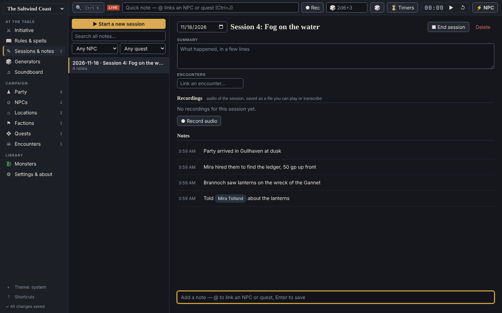

- **▶ Start a new session** creates today's session and makes it **LIVE**. The quick-note field in
  the top bar always writes to the live session, from any screen: press **Ctrl+J**, type, press
  **Enter**.
- **Link NPCs and quests while you type** by typing `@` followed by a name: pick from the list with
  the arrow keys and **Enter** or **Tab**. If the NPC doesn't exist yet, you can create them right
  there. Links survive renames, and the NPC's page lists the notes that mention them.
- Each session has a date, an optional title, a summary, linked encounters and
  [recordings](#recording-a-session).
- **End session** stops it being live. **Make live** on an older session sends quick notes there.
- Hover over a note to edit it (✎) or delete it (×).
- **Search all notes** at the top of the list, and narrow by NPC or quest with the two drop-downs.

Several other things can add notes for you: **→ notes** on a dice roll, **End combat…** in the tracker,
generator results, the emergency NPC panel and finished recordings.

---

## Running combat: the initiative tracker

The tracker (**Ctrl+I**) is built for the middle of a fight: everything is one click or one key.

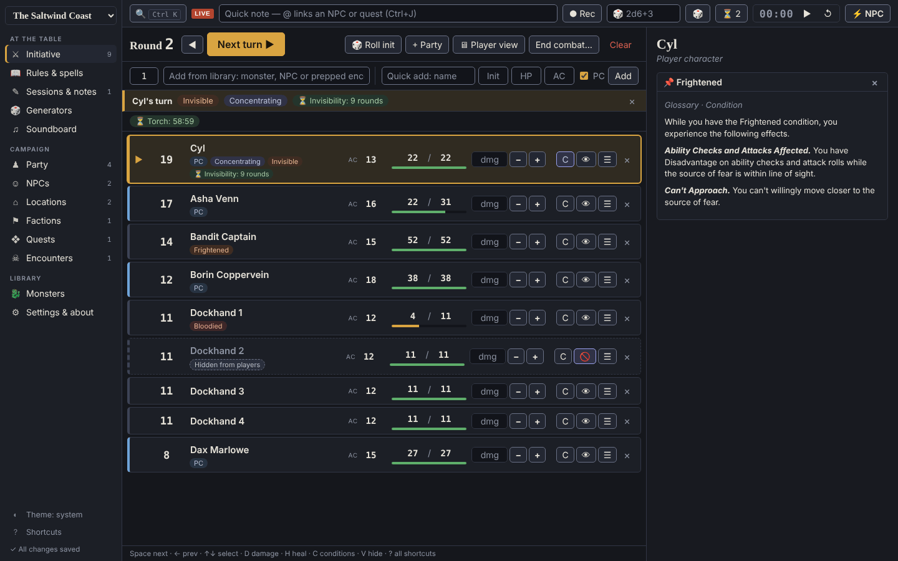

### Adding combatants

- **Run encounter** from an encounter, or type an encounter name into **Add from library**.
- **Add from library** also finds monsters and NPCs. For monsters, set how many in the small
  number box first.
- **+ Party** loads your saved party.
- **Quick add** takes a name and optional initiative, HP and AC. Tick **PC** for player
  characters, which stay when combat ends.
- **🎲 Roll init** rolls initiative for every monster and NPC. Player characters keep whatever
  you typed.

### Running turns

- **Next turn ▶** (or **Space**, **→** or **N**) moves to the next combatant. Going past the
  bottom starts a new round. **◀** (or **←** or **P**) goes back.
- Combatants whose HP is tracked are greyed out and skipped at 0 HP. Combatants without HP (usually
  player characters) are never skipped.
- Click a row, or use **↑** and **↓**, to select a combatant. The right-hand panel shows its stat
  block, with every attack, damage and save number clickable to roll.
- You can type straight into any initiative, name, AC or HP box.

### Damage, healing and conditions

- **Damage:** type a number in the **dmg** box and press **Enter**, or press **D** to jump to the
  selected combatant's box. **Heal:** type `+5`, use the **+** button, or press **H**.
- The health bar turns amber and a **Bloodied** tag appears at half HP or below.
- **Conditions:** open a combatant's ☰ menu, or press **C**, then click a condition or press the
  key shown beside it. Exhaustion counts up in levels. Click a condition chip to remove it, and
  hover over one to read its rules.

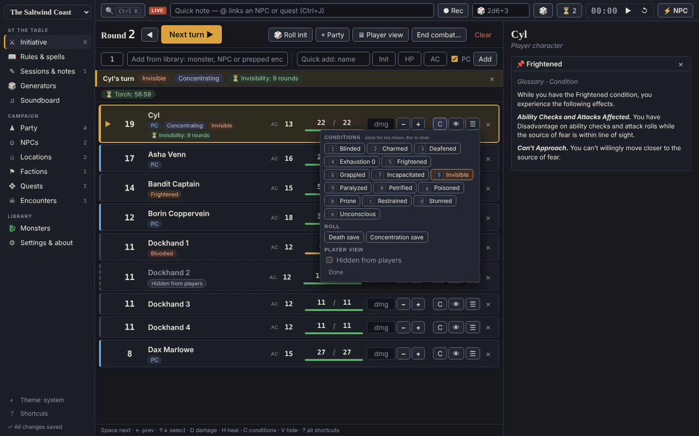

- **Concentration:** the **C** button on a row marks a combatant as concentrating. When they take
  damage, a banner shows the Constitution save DC (10, or half the damage if higher) with a
  **Roll save** button. It's a reminder only: you decide what happens.
- **Hidden from players:** the 👁 button (or **V**) hides a combatant from the
  [player view](#the-player-view). Hidden rows are dashed and labelled "Hidden from players".
- The ☰ menu also has **Death save** and **Concentration save** rolls.

### Turn reminders

When a combatant with conditions, concentration or an attached timer starts their turn, a banner
lists them so nothing gets forgotten. Dismiss it with ×; it comes back on the next turn that needs
it.

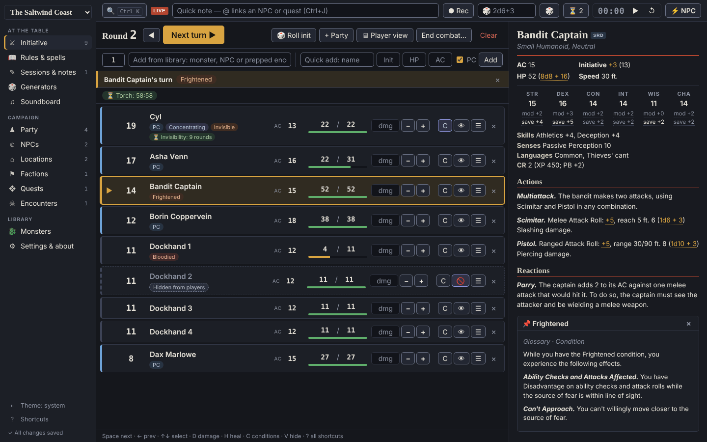

### Ending a fight

**End combat…** asks for optional notes, then (both on by default):

- saves who is standing, who is down and your notes to the live session's log, and
- clears monsters and NPCs from the tracker while keeping the party.

**Clear** removes everyone, with Undo.

The tracker is saved continuously. If Roll Ready closes mid-fight, the fight is still there when
you open it again, round and turn included.

---

## The player view

The player view is a second window for a TV, projector, second monitor or shared screen. It shows
the turn order, whose turn it is, the round, conditions and, optionally, a rough health word for
each combatant.

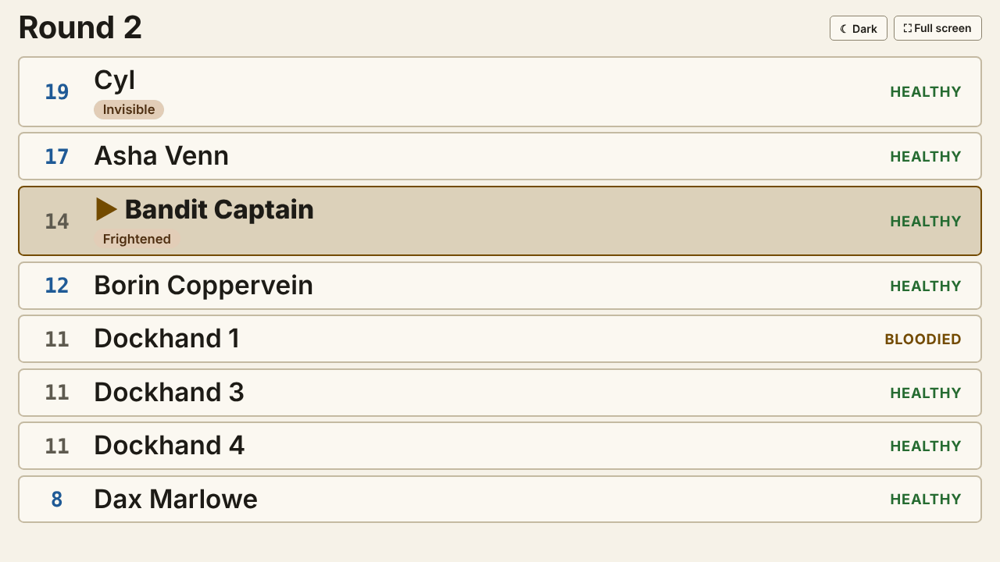

It **never** shows HP numbers, AC, stat blocks, your notes, or anyone you've hidden.

- **Open it:** press **Ctrl+Shift+P**, use **🖥 Player view** in the tracker, or use the command
  palette. Press **Ctrl+Shift+P** again to close it.
- **Move it** to another screen like any window. **Full screen** (or **F11**) fills whichever screen
  it is on; **Esc** leaves full screen.
- **Send to display…** in the **🖥 Player view** menu appears when more than one screen is
  connected, and opens the view on the one you pick.
- It **remembers** its size, position and screen. If that screen is no longer connected, it opens
  on your main screen instead.
- The **Light/Dark** and **Full screen** buttons fade away, along with the mouse pointer, when
  the mouse is still.
- It updates as you work. Closing it doesn't affect the tracker.

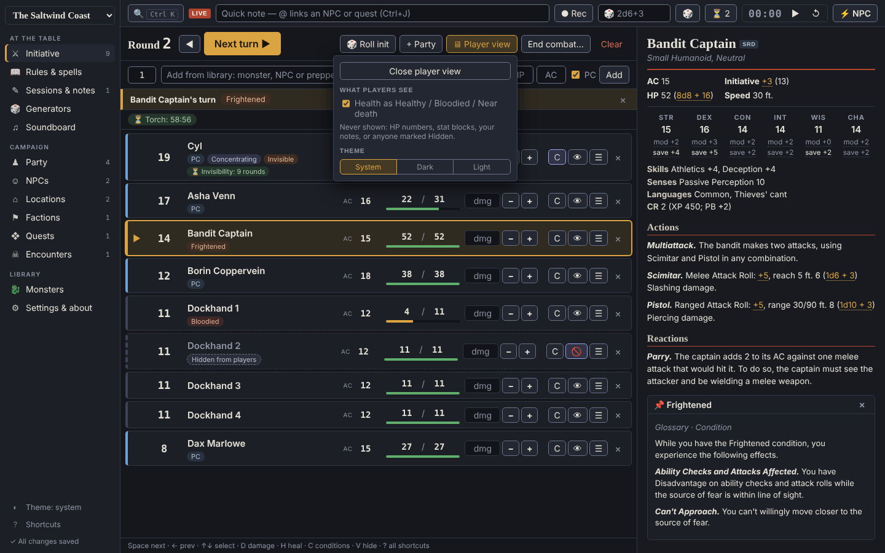

The **🖥 Player view** menu also controls what players see:

- **Health as Healthy / Bloodied / Near death:** untick it to hide health altogether.
- **Theme:** System, Dark or Light, for the player view only.

The player view also shows [pictures](#showing-pictures-to-the-players) and soundboard
[pictures and video](#soundboard) when you send them.

---

## Dice

- **Quick roll:** press **Ctrl+E**, type a roll, press **Enter**. The total appears beside the box;
  hover over it for the details.
- **Click to roll:** any attack bonus, damage roll, ability or save in a stat block.
- **Dice roller (Ctrl+D):** a window you can drag anywhere, with a box for typing rolls, a builder
  (dice, modifier, repeat, advantage or disadvantage) and the history of your rolls.

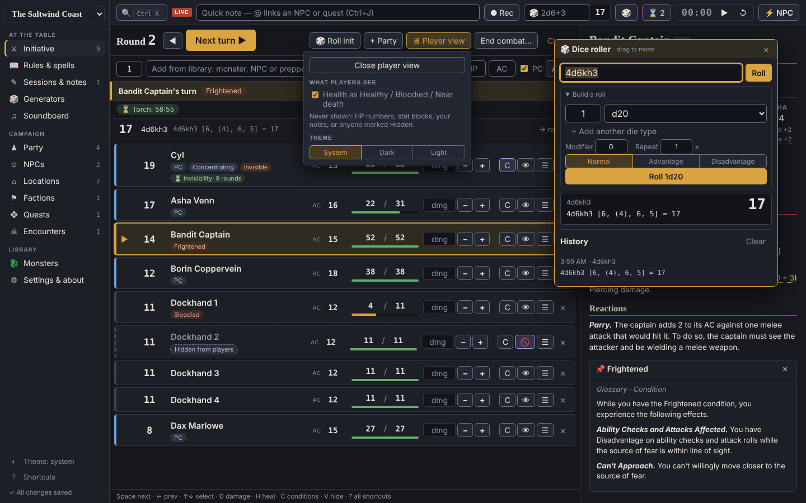

What you can type:

| Roll | Meaning |
|---|---|
| `d20`, `1d20+5`, `2d6+3` | Ordinary rolls and modifiers |
| `1d12 + 2d4 - 1` | Several kinds of dice together |
| `2d20kh1` / `2d20kl1` | Advantage / disadvantage (keep highest or lowest 1) |
| `4d6kh3` | Keep the highest 3 (also `kl`, `dh` and `dl` to keep or drop) |
| `d%` | A d100 |

Every die is shown, not just the total. Dice that were dropped appear in brackets, like
`4d6kh3 [(1), 4, 6, 3] = 13`. If Roll Ready can't read what you typed, it says what's wrong.

**→ notes** beside a roll copies it into the live session's notes. The history is kept between
sessions; **Clear** empties it.

---

## Countdown timers and the stopwatch

**⏳ Timers** in the top bar opens the timer panel. Run as many timers as you like at once.

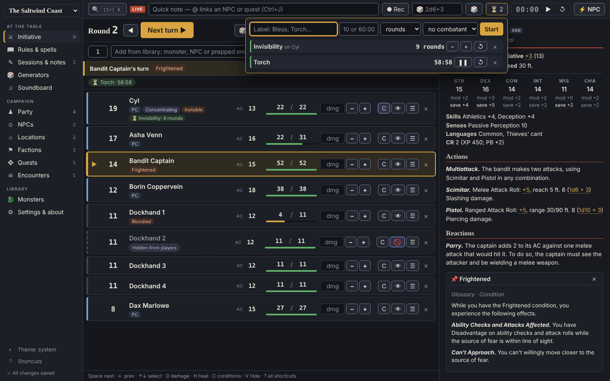

- Give the timer a label, a length and a unit: **rounds**, **minutes** or **seconds**. You can
  also type a clock time like `60:00`.
- **Round timers** count down by themselves each time the tracker starts a new round.
- **Attach a timer to a combatant** (for a spell effect, say) with the last drop-down. The timer then
  shows on that combatant's row and in their turn reminder, and is removed if they're removed
  from combat.
- When a timer runs out, it turns red, says **EXPIRED**, and a message appears. It stays until you
  clear it, so it's never missed. Click an expired timer chip to clear it.
- Pause, resume, restart (↺), adjust round timers with − and +, or remove with ×.

Timers belong to the campaign and keep running across restarts.

The **stopwatch** (00:00 in the top bar) is separate: **Ctrl+T** starts and pauses it, ↺ resets it.

---

## Rules, spells and monsters

### Rules & spells

**Rules & spells** (**Ctrl+L** from anywhere) searches the SRD 5.2 as you type: spells, the rules
glossary, conditions, core rules, equipment, magic items and monsters.

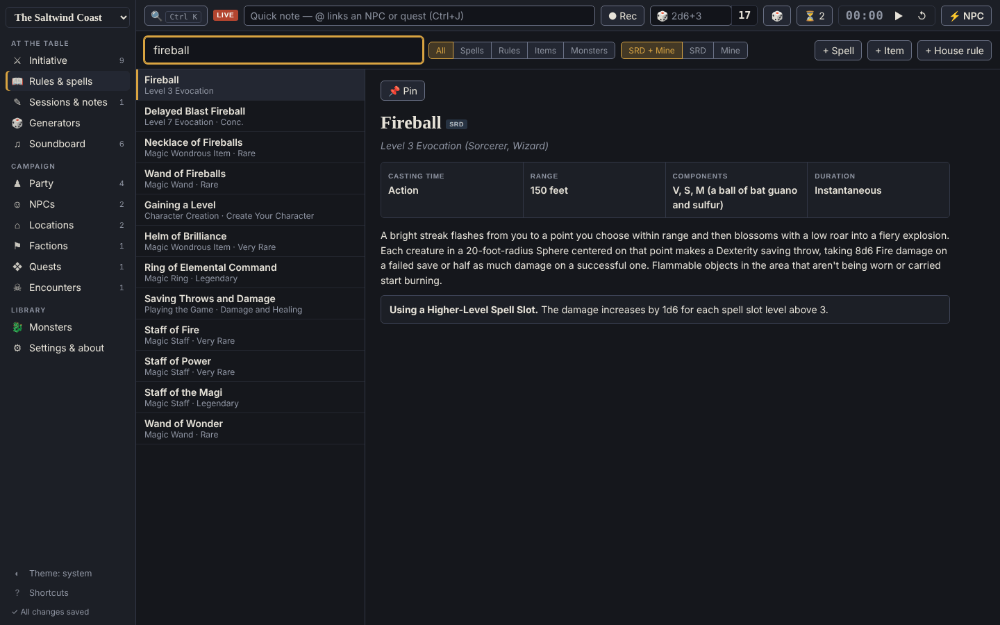

- The top result shows straight away; **↑** and **↓** move through the list.
- Filter by type (Spells, Rules, Items, Monsters) and by source (**SRD**, your own **Mine**, or both).
- **+ Spell**, **+ Item** and **+ House rule** add your own entries, marked **Mine**. Only your own
  entries can be edited or deleted.
- **📌 Pin** keeps an entry beside the initiative tracker ([pinned panels](#pinned-reference-panels)).

The SRD leaves some published content out. If you search for something that isn't included, Roll
Ready tells you so and where to look, and for monsters offers to add it as homebrew.

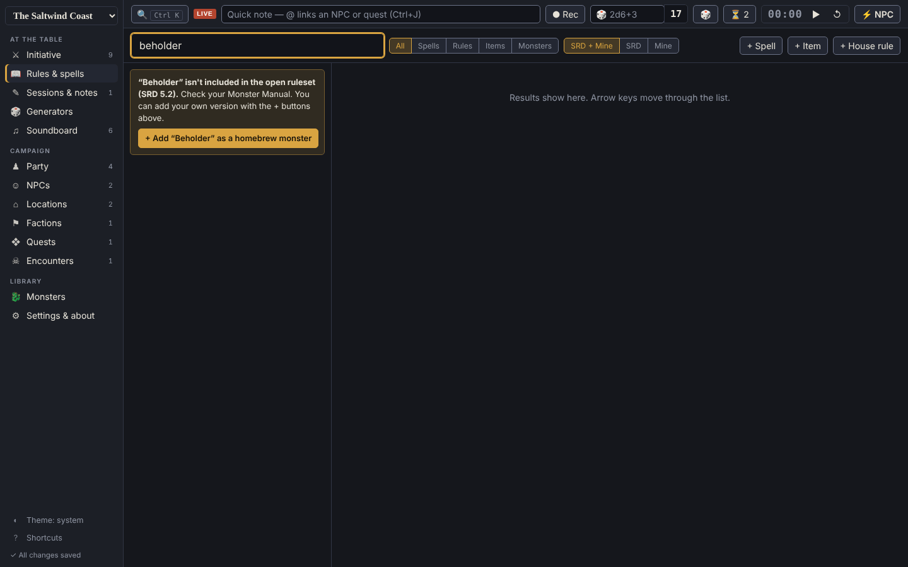

Spells named after characters appear in the SRD under plain names, so search for "acid arrow"
rather than a wizard's name. Roll Ready suggests the plain name when it can.

### Monsters

**Monsters** is the full monster library, shared by all your campaigns.

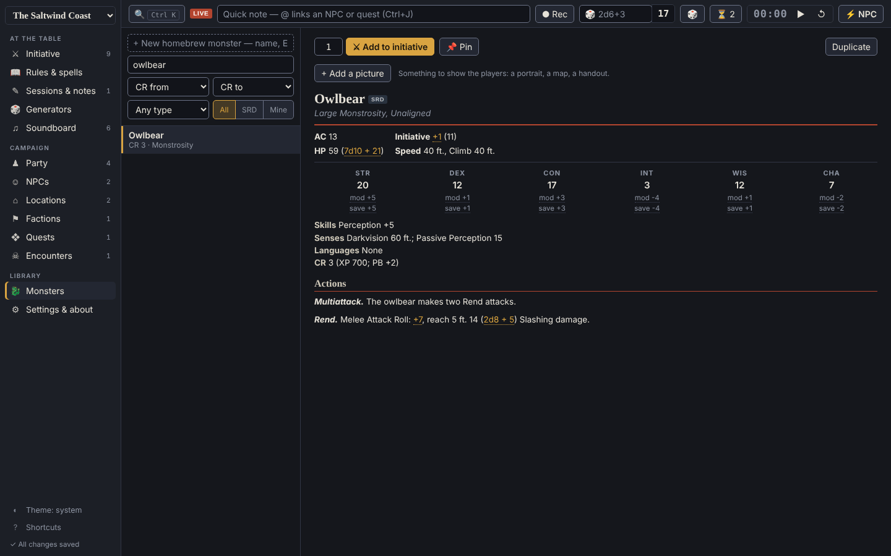

- Search by name or type, and filter by challenge rating (from and to), creature type and source.
- Stat blocks use the 2024 layout, and every attack, damage, ability and save is clickable to roll.
- **⚔ Add to initiative** adds the number of creatures in the box beside it.
- **Duplicate** makes your own editable copy, so you can reskin an SRD monster. SRD monsters
  themselves can't be changed.
- **+ New homebrew monster** at the top of the list creates one from scratch. In the editor, write
  each trait or action as a paragraph starting with its name and a full stop:
  `Bite. Melee Attack Roll: +5, reach 5 ft. 7 (1d8 + 3) Piercing damage.`
- Any monster, SRD ones included, can have a [picture](#showing-pictures-to-the-players).

## Pinned reference panels

Pin stat blocks, spells and rules (with **📌 Pin** in the lookup or the monster library) to keep
them in the tracker's side panel, under the selected combatant. Pin as many as you like; each can
be collapsed or unpinned with ×. Pins are saved per campaign. The tracker screenshot above shows
the Frightened condition pinned.

## Showing pictures to the players

Give an NPC, location or monster a picture (a portrait, a map, a handout) with **+ Add a picture**
on its page. **▶ Show to players** puts it on the player view, covering the initiative list, until
you click **■ Hide from players**.

- The player view has to be open first (**Ctrl+Shift+P**).
- When you select a combatant in the tracker, its picture and a show button appear in the side
  panel.
- Only one picture or video is on the player view at a time; showing another replaces it.
- **■ Stop all** on the soundboard, or "Stop all sounds" in the command palette, also takes the
  picture down.

Pictures are copied into Roll Ready, so you can move or delete the originals. Supported:
png, jpg, gif, webp, avif and bmp.

---

## Generators

**Generators** rolls on tables of names, places, rumors, weather and treasure.

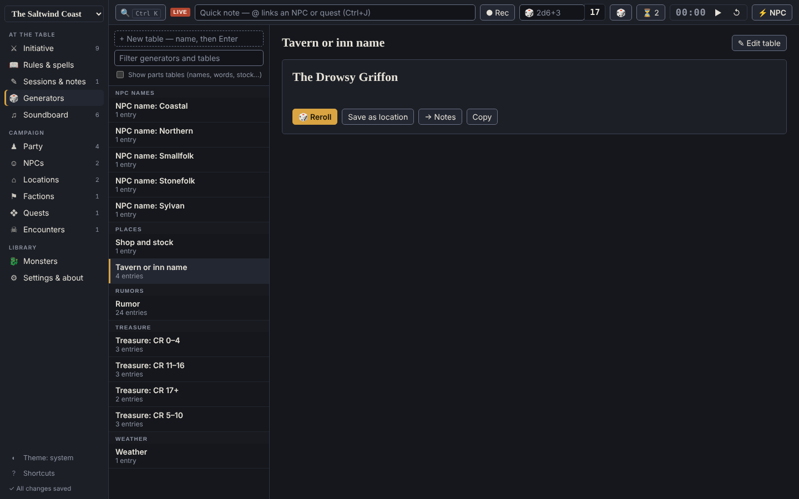

Built in:

| Generator | What it makes | Saves as |
|---|---|---|
| NPC names | Five naming styles: Northern, Sylvan, Stonefolk, Coastal, Smallfolk | An NPC |
| Tavern or inn name | "The Drowsy Badger" | A location |
| Shop and stock | A shop, a few items for flavour, and a quirk | A location |
| Rumor | A one-line rumor | A quest |
| Weather | Temperature, sky and wind | A session note |
| Treasure | Coins and valuables, in four challenge-rating tiers | A session note |

- **🎲 Reroll** (or **R**) rolls again. **Earlier results** keeps the last few; click one to bring
  it back.
- The save button turns the result into the entry shown in the table above. **→ Notes** adds it
  to the live session's notes, and **Copy** puts it on the clipboard.

### Editing tables and making your own

Every table can be changed. **✎ Edit table** shows its entries, one per line:

- Start a line with a number and a bar to make it more likely: `3| The Drowsy Badger` comes up
  three times as often as an ordinary line.
- `{key}` rolls on another table, for example `{tavern_adj}`. `{key x3}` rolls three different
  entries from it.
- `{2d6}` rolls dice; `{2d6*10}` rolls and multiplies.

Roll Ready warns you if an entry uses a table key that doesn't exist.

Type a name in **+ New table** to make your own table. Choose whether it shows as a generator or
is just a *parts table* used by other tables (tick **Show parts tables** to see those), and what a
result can become. Your edits to built-in tables are kept when Roll Ready is updated. Generator
tables are shared by all your campaigns.

All the built-in table content was written for Roll Ready.

## Emergency NPC

For the moment a player does something unexpected and you need a character *right now*. Press
**Ctrl+N**, click **⚡ NPC** in the top bar, or choose "Emergency NPC" in the command palette. A
complete character is on screen immediately.

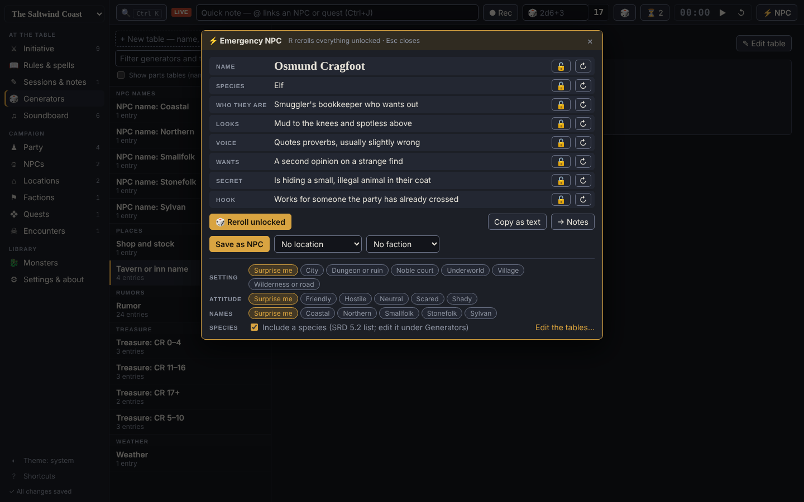

You get a name, an optional species, who they are, how they look, a voice or mannerism to act
out, what they want right now, a secret, and a hook into the current scene.

- **🔓 Lock** a line to keep it, then **🎲 Reroll unlocked** (or **R**) to replace everything
  else. **↻** rerolls a single line.
- **Filters** (optional): setting (city, village, wilderness, dungeon, noble court, underworld),
  attitude to the party (friendly, neutral, hostile, scared, shady) and naming style. **Surprise
  me** picks at random. Changing a filter rerolls only the line it affects.
- **Species** can be turned off for tables that don't use them. The list is from the SRD 5.2 and
  can be edited under Generators.
- **Save as NPC** creates a real NPC tagged `emergency`, optionally placed at a location and in a
  faction, so you can find and flesh them out later.
- **Copy as text** and **→ Notes** keep a character you don't want to save.
- **Recent** keeps the last 20 characters. Click one to bring it back.

**Esc** closes the panel. Its tables are under Generators (the "Emergency NPC" group), and you can
edit them or add your own. A new table whose key starts with `enpc_occupation_` or `enpc_hook_`
appears as a new setting or attitude filter.

---

## Soundboard

The soundboard is a grid of buttons, like a stream deck. Each button can hold a sound, a picture
or video, or a picture and a sound together. Sound plays on your computer; pictures and video
appear on the [player view](#the-player-view).

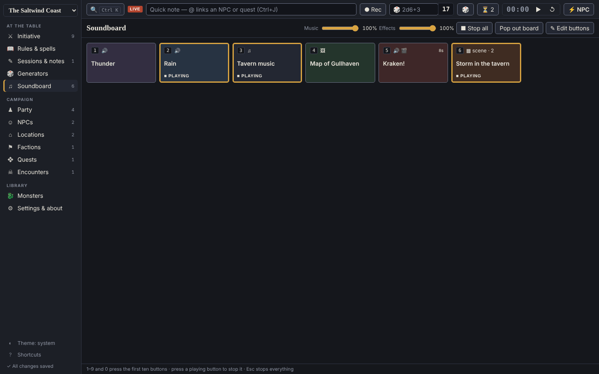

### Playing

- Click a button to play it, and click it again to stop. Playing buttons have a gold border and say
  **PLAYING**.
- The keys **1** to **9** and **0** press the first ten buttons. **Esc** or **■ Stop all** stops
  everything and takes any picture down.
- The **Music** and **Effects** sliders set a master volume for each kind, on top of each button's
  own volume.
- In the command palette, type "play" and a button's name to fire it.

### Setting up buttons

Click **✎ Edit buttons**, then **+ Add a button**, or click a button to change it.

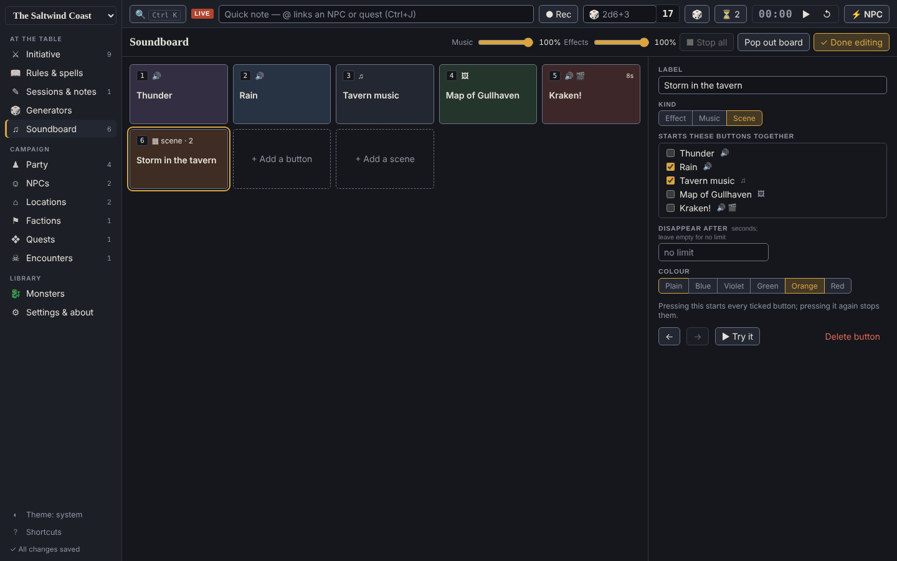

| Setting | What it does |
|---|---|
| **Label** | The button's name. Filled in from the file name if you leave it empty. |
| **Kind** | **Effect** or **Music** (which master volume it follows), or **Scene** (see below). |
| **Sound** | A sound file. Supported: mp3, wav, ogg, m4a, aac, flac, opus. |
| **Picture or video** | Shown on the player view. Pictures: png, jpg, gif, webp, avif, bmp. Video: mp4, webm, mov. |
| **Volume** | This button's own volume. |
| **Fade in and out** | Seconds to fade the sound up when it starts and down when it stops. |
| **Disappear after** | Seconds until the button stops by itself and its picture disappears. Leave it empty for no limit. |
| **Loop until stopped** | Repeats the sound or video until you press the button again. |
| **Colour** | Helps you find buttons at a glance. |

**← →** change a button's place in the grid, and **▶ Try it** plays it. **Delete button** removes
it, with Undo.

With no time limit, a picture stays until you press its button again, a video closes when it ends,
and a sound on its own stops when it finishes.

Files are copied into Roll Ready, so buttons keep working if you move or delete the originals.

### Scenes

A **scene** is one button that starts several others at once and stops them together. For example,
"Storm in the tavern" could start the rain, the tavern music and the map. Choose **+ Add a scene**
in edit mode and tick the buttons it should start. A scene can have its own time limit.

### The pop-out board

**Pop out board** (or **Ctrl+Shift+B**) opens the buttons in a small window that stays on top of
other windows. Move and resize it anywhere; it remembers where you left it. Number keys,
**Esc** and **■ Stop all** work in it too.

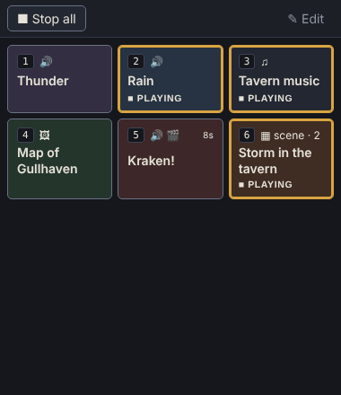

Buttons are set up in the main window. **✎ Edit** in the pop-out brings the main window forward.

Pictures and video need the player view to be open. Only one picture or video shows at a time;
sounds can overlap.

---

## Recording a session

Roll Ready can record your session's audio from your computer's microphone, so you can listen back
or turn it into a transcript.

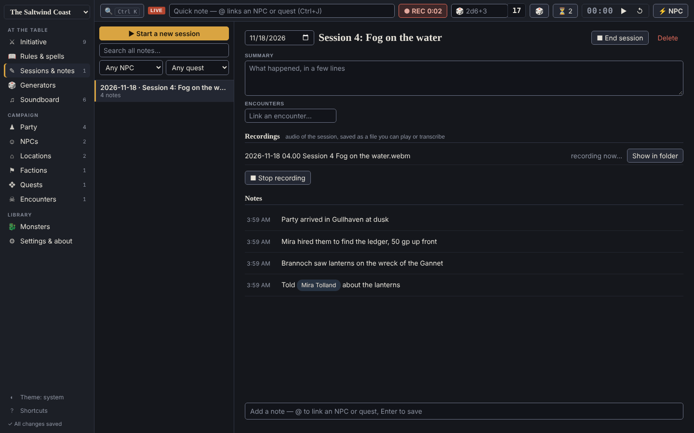

- Click **● Rec** in the top bar. It turns red and shows the running time. Click it again to stop.
- The recording belongs to the live session. If no session is live, one is started for you.
- When you stop, a note with the length is added to the session, and the file is listed under
  **Recordings** on the session's page, with **Show in folder** to find it.
- You can also start and stop recording from the session's page.
- Recording uses your system's default microphone. The first time, your computer may ask whether
  Roll Ready can use it.

Recordings are saved as `.webm` audio files, about 20 MB per hour. They're written a few seconds
at a time, so if the computer crashes you lose at most the last few seconds. They play in VLC and
in web browsers, and most transcription tools accept them. Roll Ready does not transcribe or
upload anything.

Deleting a recording asks first, because the file is removed for good.

> **Tell everyone at the table before you record.** In some places it is illegal to record people
> without their consent.

---

## The command palette

Press **Ctrl+K** from anywhere and start typing.

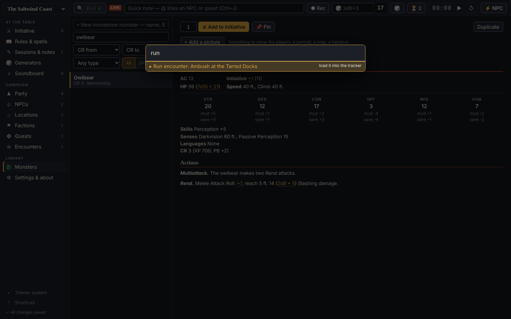

- **Jump to** any NPC, location, faction, quest, encounter, session, monster, spell, item or rule by
  name or tag.
- **Run an action:** next or previous turn, roll dice, open the dice roller, start a timer, new
  note, emergency NPC, pop out the player view or soundboard, record, back up, stop all sounds,
  switch theme, go to any screen, **Run encounter: …** for each encounter, and **Play: …** for each
  soundboard button.
- **Type a roll** like `3d8+2` and press **Enter** to roll it.

Use **↑** **↓** and **Enter**, or click. **Esc** closes it.

---

## Settings

**Settings & about** holds:

- **Campaign:** the name, the rules system (free text, so 2014-rules campaigns can live alongside),
  and campaign notes. Create a new campaign or delete this one here.
- **Appearance:** follow your system, dark or light. The player view has its own theme setting.
- **Conditions:** the list used in the tracker. Rename, add or remove conditions, mark one as
  having levels (like Exhaustion), and edit its rules text, if your table plays differently.
- **Encounter difficulty:** the XP budget per character for each party level, for Low, Moderate and
  High. The defaults come from the SRD 5.2; change any number to match your own books or house
  rules.
- **Keyboard shortcuts:** the full list.
- **Your data:** where your data is, backups and restoring (below).
- **About & credits:** the version and the SRD 5.2 licence notice.

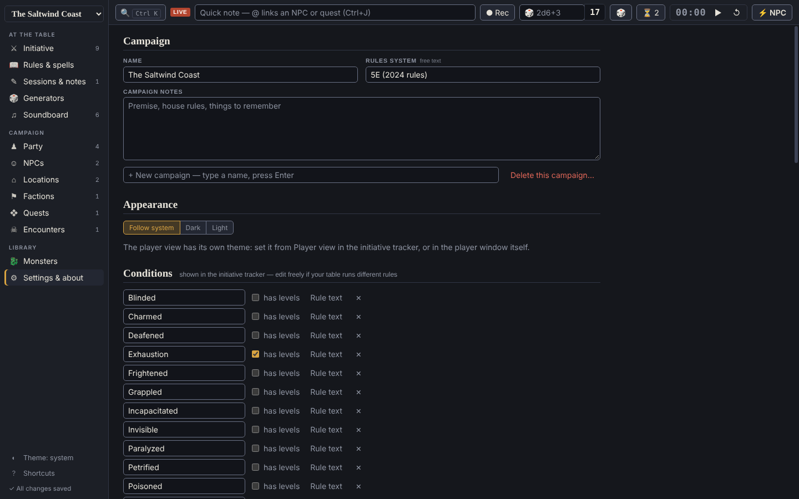

The theme can also be switched at the bottom of the sidebar (system → dark → light).

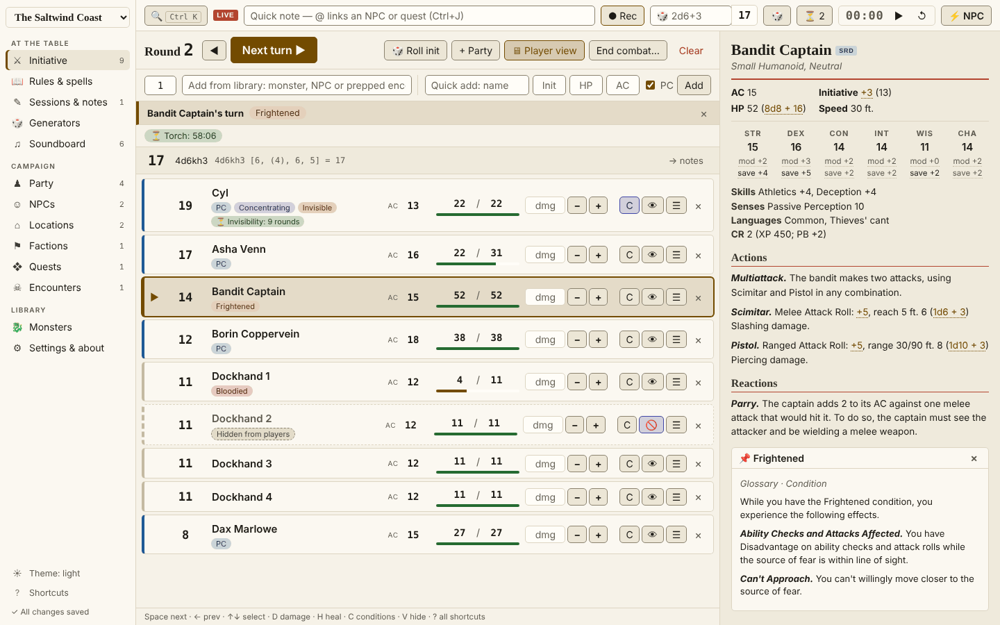

---

## Your data, backups and restoring

Everything is on your computer. Nothing is sent anywhere, and no account is needed.

Your data is one file plus two folders beside it:

| | Windows | macOS |
|---|---|---|
| Data file | `%APPDATA%\Roll Ready\roll-ready.sqlite` | `~/Library/Application Support/Roll Ready/roll-ready.sqlite` |
| Soundboard files and pictures | `roll-ready-media` in the same folder | the same |
| Recordings | `roll-ready-recordings` in the same folder | the same |

**Settings → Your data → Show in folder** opens it.

### Backing up

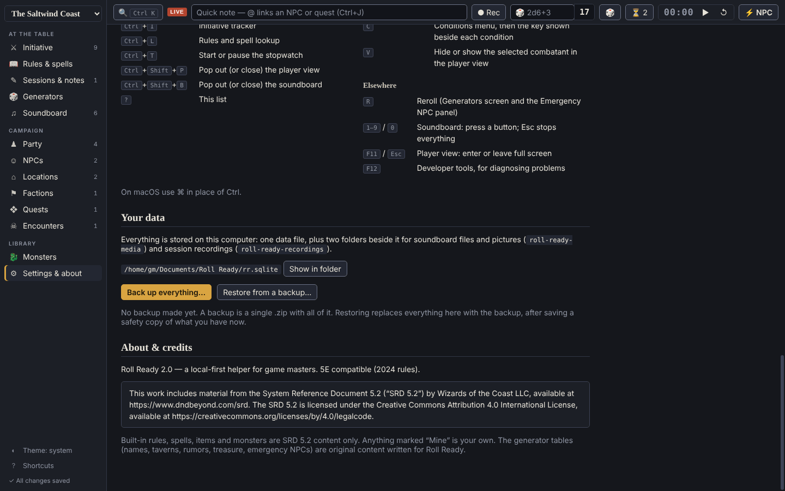

**Back up everything…** (also in the command palette) saves a single `.zip` file holding every
campaign, all soundboard files and pictures, and all recordings. Settings shows when you last made
one. Keep backups somewhere other than your computer, such as a USB stick or cloud storage.

A backup can be at most 4 GB. If yours would be larger, Roll Ready says so; remove some large
videos or old recordings, or copy the data folder by hand.

### Restoring

**Restore from a backup…** replaces **everything** in Roll Ready with the backup's contents, after
asking you to confirm. Before it does, it saves a safety copy of what you have now in a
`roll-ready-backups` folder beside your data, in case you restored the wrong file. Delete old
safety copies from there when you no longer need them.

Restoring is also how you move Roll Ready to another computer: back up on one, restore on the other.

---

## Keyboard shortcuts

Press **?** on any screen (while not typing in a box) to see these in the app.

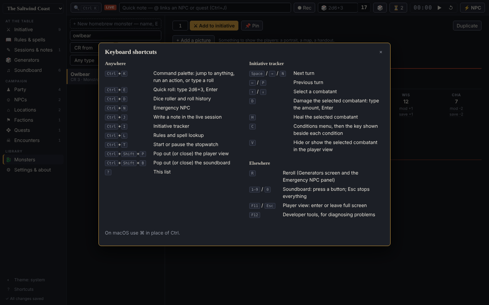

### Anywhere

| Keys | What it does |
|---|---|
| **Ctrl+K** | Command palette |
| **Ctrl+E** | Quick roll |
| **Ctrl+D** | Dice roller and roll history |
| **Ctrl+N** | Emergency NPC |
| **Ctrl+J** | Write a note in the live session |
| **Ctrl+I** | Initiative tracker |
| **Ctrl+L** | Rules and spell lookup |
| **Ctrl+T** | Start or pause the stopwatch |
| **Ctrl+Shift+P** | Pop out or close the player view |
| **Ctrl+Shift+B** | Pop out or close the soundboard |
| **?** | Shortcut list |

### Initiative tracker

| Keys | What it does |
|---|---|
| **Space**, **→** or **N** | Next turn |
| **←** or **P** | Previous turn |
| **↑** / **↓** | Select a combatant |
| **D** | Damage the selected combatant: type the amount, **Enter** |
| **H** | Heal the selected combatant |
| **C** | Conditions menu, then the key beside a condition |
| **V** | Hide or show the selected combatant in the player view |

### Elsewhere

| Keys | What it does |
|---|---|
| **R** | Reroll (Generators and the Emergency NPC panel) |
| **1**–**9**, **0** | Soundboard: press a button |
| **Esc** | Soundboard: stop everything. Also closes panels and menus. |
| **F11** / **Esc** | Player view: enter or leave full screen |
| **F12** | Developer tools, for diagnosing problems |

On macOS, use ⌘ in place of Ctrl.

---

## Troubleshooting

**Pictures or videos don't appear.** Open the player view first (**Ctrl+Shift+P**). Pictures and
video only show there.

**No sound from the soundboard.** Check the Music and Effects sliders and the button's own volume,
then your computer's volume and output device.

**Recording says it can't reach a microphone.** Check that a microphone is connected and that Roll
Ready is allowed to use it: on macOS in System Settings → Privacy & Security → Microphone, and on
Windows in Settings → Privacy & security → Microphone.

**The player view opened on the wrong screen.** Use **Send to display…** in the tracker's
**🖥 Player view** menu, or drag it and it will remember the new place.

**I deleted something by mistake.** Click **Undo** in the message at the bottom of the window. If
it has gone, restore from your most recent backup.

**Windows or macOS warns about the app the first time.** The installers aren't signed yet. On
Windows choose **More info → Run anyway**; on macOS right-click the app and choose **Open**.

**Something else went wrong.** Press **F12** to open the developer tools and copy any red text from
the **Console** tab. It helps whoever is fixing the problem.
